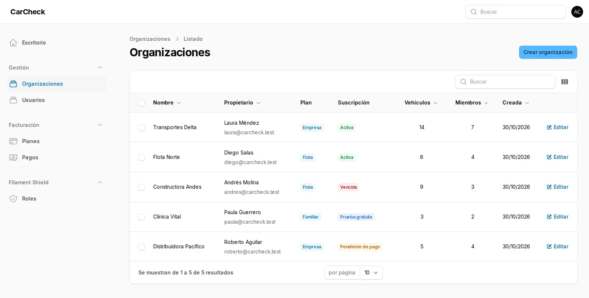
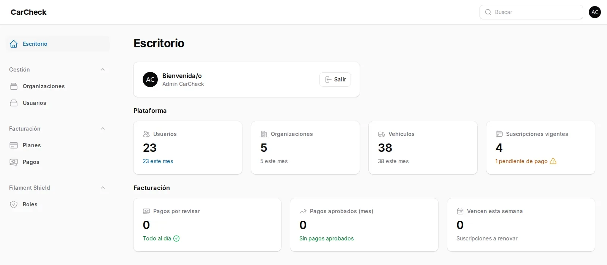
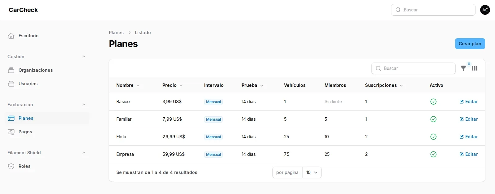
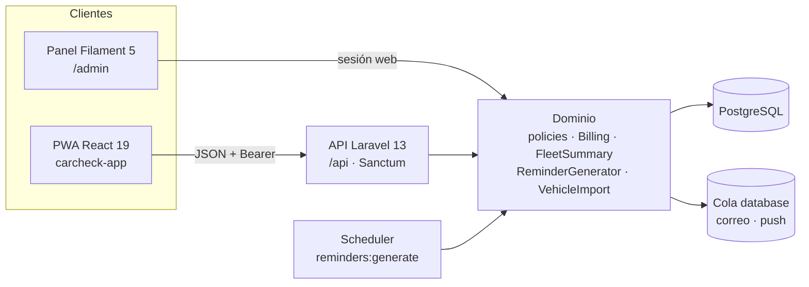

<p align="center">
  
</p>

<h1 align="center">CarCheck</h1>

<p align="center">
  <strong>El historial completo de cada vehículo, en un solo lugar.</strong><br>
  Backend de CarCheck: API REST, panel de administración y motor de recordatorios<br>
  para conductores, familias y flotas de empresa.
</p>

<p align="center">
  
  
  
  
  
  
</p>

<p align="center">
  <a href="#qué-es">Qué es</a> ·
  <a href="#capturas">Capturas</a> ·
  <a href="#roles-y-permisos">Roles</a> ·
  <a href="#puesta-en-marcha">Empezar</a> ·
  <a href="#api">API</a> ·
  <a href="#planes">Planes</a> ·
  <a href="#despliegue">Despliegue</a>
</p>

---



## Qué es

CarCheck es un SaaS de mantenimiento de vehículos **multiusuario desde el primer día**:
una persona con su carro, una familia que comparte dos o tres vehículos, o una empresa con
una flota de 75 unidades y conductores que reportan desde el teléfono.

Este repositorio es el **backend**: expone la API que consume la PWA
([`carcheck-app`](https://github.com/rommelescorihuela/carcheck-app)), sirve el panel de administración en `/admin` y ejecuta los
recordatorios programados.

| Problema real | Cómo lo resuelve CarCheck |
|---|---|
| “¿Cuándo cambié el aceite?” | Historial de mantenimiento por vehículo, con ítems, costos y comprobantes. |
| “El seguro vence y nadie se acordó” | Recordatorios por fecha y kilometraje, con aviso in-app, correo y push. |
| “No sé cuánto gasta la flota” | Reporte de gastos por vehículo y periodo, exportable a CSV. |
| “Los conductores no reportan” | Rol `driver` que registra combustible y servicios, con atribución de quién lo hizo. |
| “Cargar 40 vehículos a mano es imposible” | Alta masiva desde CSV validada contra los límites del plan. |

## Capturas

| Escritorio | Facturación |
|---|---|
|  |  |

El panel usa el mismo azul profundo (`#1d4a70`) que la landing y la PWA, con navegación por
áreas: **Gestión** (organizaciones, usuarios), **Facturación** (planes, pagos) y **Filament Shield**
(roles).

## Roles y permisos

La autorización es **de dominio**, no solo del panel. La propiedad de un vehículo se resuelve por
`owner_type`/`owner_id` (un usuario **o** una organización) y el rol vive en el pivot
`organization_user`.

| Capacidad | `super_admin` | `owner` | `admin` | `member` | `driver` |
|---|:---:|:---:|:---:|:---:|:---:|
| Entrar a `/admin` | ✅ | — | — | — | — |
| Crear su organización | — | ✅ | ✅ | ✅ | ✅ |
| Editar la organización y su plan | ✅ | ✅ | — | — | — |
| Invitar y quitar miembros | ✅ | ✅ | ✅ | — | — |
| Nombrar o quitar administradores | ✅ | ✅ | — | — | — |
| Traspasar la propiedad | ✅ | ✅ | — | — | — |
| Agregar, editar y dar de baja vehículos | ✅ | ✅ | ✅ | — | — |
| Registrar combustible y mantenimiento | ✅ | ✅ | ✅ | ✅ | ✅ |
| Corregir una entrada que él mismo registró | ✅ | ✅ | ✅ | ✅ | ✅ |
| Ver documentos, vencimientos y reportes | ✅ | ✅ | ✅ | ✅ | ✅ |
| Gestionar pagos y comprobantes | ✅ | ✅ | ✅ | — | — |

Reglas que sostienen lo anterior:

- **Solo el propietario** puede invitar o quitar administradores. Al cambiar de propietario, el
  anterior baja a `admin` automáticamente.
- El `driver` existe para reportar desde la calle: **no** administra el garaje ni la facturación.
- Una suscripción **vencida o pendiente de pago conserva la lectura**, pero bloquea altas nuevas
  hasta regularizarse.
- Los límites del plan son **bloqueantes** (vehículos y miembros), también en la importación CSV.
- Una cuenta sin suscripción usa el plan activo más barato como referencia de límites.

## Funcionalidades por módulo

| Módulo | Qué incluye |
|---|---|
| **Identidad** | Registro, login Sanctum, refresh de token con reintento único en el cliente, cierre de sesión, baja de cuenta con soft delete y protección del `owner`. |
| **Organizaciones** | Miembros con rol, invitaciones por enlace con caducidad, cambio de propietario, ámbito personal u organizacional. |
| **Vehículos** | Marca, modelo, año, placa, VIN, tipo, combustible, odómetro, color, notas, foto y traspaso entre ámbitos. |
| **Mantenimiento** | Catálogo de tipos, planes por kilometraje y/o tiempo, registros con ítems (repuesto/mano de obra), adjuntos y cálculo de vencimiento. |
| **Combustible** | Cargas con litros, precio, odómetro y estación; rendimiento km/l, costo por km y detección de saltos de odómetro. |
| **Documentos** | Seguro, revisión, impuestos, licencia… con vencimiento, archivo y estado (`vigente`, `por vencer`, `vencido`). |
| **Recordatorios** | Generación diaria por scheduler, sincronización bajo demanda y descarte por usuario. |
| **Notificaciones** | Bandeja in-app inmediata; correo y push web (VAPID) **encolados**; preferencias por canal. |
| **Facturación** | 4 planes, prueba de 14 días, pagos manuales con comprobante (transferencia, Pago móvil, Zelle, Binance), aprobación/rechazo y multimoneda. |
| **Reportes** | Gastos por periodo y vehículo, comparativa combustible/mantenimiento y exportación CSV autenticada. |
| **Flotas** | Vista consolidada por rango de fechas, atribución `recorded_by`, alta masiva desde CSV y límites por plan. |
| **Panel** | Organizaciones, usuarios, planes y pagos; widgets de plataforma y facturación; roles con Filament Shield. |

## Arquitectura



- **Sin base de datos por tenant.** La propiedad es polimórfica (`User` u `Organization`) mediante
  el trait `OwnedByUserOrOrganization`; cada consulta se acota con `VehicleScope`. Es el mismo
  patrón de `gym_id` de App Gym, sin la complejidad de Stancl.
- **Una sola fuente de verdad para el negocio.** `Billing`, `FleetSummary`, `ReminderGenerator` y
  `VehicleImport` viven en `app/Services/`; la API y el panel los llaman, nunca reimplementan reglas.
- **Autorización en policies.** `VehiclePolicy::log` separa “registrar” de “administrar”; el resto
  de recursos delega en el vehículo dueño.
- **Roles de plataforma vs. roles de organización.** Spatie + Shield se reservan a `super_admin`
  y `panel_user`; los roles `owner|admin|member|driver` son del dominio y no se mezclan.

## Stack

| Capa | Tecnología |
|---|---|
| Lenguaje | PHP 8.3 |
| Framework | Laravel 13 |
| Panel | Filament 5 + Filament Shield 4 |
| API | Laravel Sanctum 4 (Bearer + refresh) |
| Base de datos | PostgreSQL (dev y prod) · SQLite en memoria en tests |
| Archivos | Spatie Media Library 11 sobre `storage/app/public` |
| Push | `web-push` con claves VAPID |
| Colas / scheduler | Driver `database` + `reminders:generate` diario |
| Estilos del panel | Tailwind 4 + Vite |

## Puesta en marcha

**Requisitos:** PHP 8.3+, Composer, Node 20+, PostgreSQL 16+.

```bash
# 1. Dependencias, .env, clave y esquema
composer run setup

# 2. Datos demo (admin, tipos de mantenimiento y catálogo de planes)
php artisan migrate --seed

# 3. API + cola + logs + Vite del panel
composer run dev
```

- API: <http://localhost:8000/api>
- Panel: <http://localhost:8000/admin>

En producción el primer administrador se crea sin seed:

```bash
php artisan admin:create admin@tudominio.com --name="Administrador"
```

### Cuentas demo

| Cuenta | Contraseña | Acceso |
|---|---|---|
| `admin@carcheck.test` | `password` | Super admin: panel `/admin` completo. |
| `demo@carcheck.test` | `password` | Usuario estándar de la API. |

> El seed **no** crea organizaciones ni vehículos: la cuenta demo arranca vacía para probar el
> flujo real de alta. Para una demo con datos, crea una organización desde la PWA o el panel.

### Comandos del día a día

```bash
composer run test                                   # config:clear + toda la suite
php artisan test --filter=AuthTest                  # una clase
php artisan test --filter=test_user_can_login       # un método
vendor/bin/pint                                     # estilo Laravel
php artisan reminders:generate                      # recordatorios a mano
php artisan optimize:clear                          # tras tocar recursos de Filament
```

## API

Base: `{APP_URL}/api`. Todas las rutas salvo `register` y `login` requieren
`Authorization: Bearer <token>`. El token dura 30 días y se renueva con `POST /token/refresh`
(con throttle propio); el cliente reintenta un 401 **una sola vez**.

| Grupo | Endpoints principales |
|---|---|
| Autenticación | `POST /register`, `POST /login`, `POST /logout`, `POST /token/refresh`, `GET /user`, `DELETE /account` |
| Organizaciones | `GET|POST /organizations`, `GET /organizations/{id}`, miembros en `/organizations/{id}/members` |
| Invitaciones | `POST /organizations/{id}/invitations`, `POST /invitations/{token}/accept` |
| Vehículos | `apiResource /vehicles`, `POST /vehicles/import`, foto y `POST /vehicles/{id}/transfer` |
| Mantenimiento | `/maintenance-types`, `/vehicles/{id}/maintenance-plans`, `/vehicles/{id}/maintenance-records`, adjuntos y `maintenance-due` |
| Combustible | `/vehicles/{id}/fuel-entries`, `/vehicles/{id}/fuel-summary`, `/fuel-entries/{id}` |
| Documentos | `/vehicles/{id}/documents`, `documents-summary`, archivo y CRUD |
| Facturación | `/billing/plans`, `/billing/subscription`, `/billing/payments` (+ comprobante, aprobar, rechazar) |
| Notificaciones | `/notifications`, preferencias, push (`public-key`, suscripciones) y aviso de prueba |
| Recordatorios | `GET /reminders`, `POST /reminders/sync`, `POST /reminders/{id}/dismiss` |
| Reportes | `GET /reports/expenses`, `GET /reports/expenses/export` |
| Flotas | `GET /fleet/summary`, `POST /vehicles/import` |

El contrato completo y comentado está en [`routes/api.php`](routes/api.php). Cada módulo tiene su
spec con reglas de negocio y códigos de error en [`SPEC-MAP.md`](SPEC-MAP.md).

### Ejemplo

```bash
TOKEN=$(curl -s -X POST http://localhost:8000/api/login \
  -H 'Content-Type: application/json' \
  -d '{"email":"demo@carcheck.test","password":"password"}' | jq -r .token)

curl -s http://localhost:8000/api/vehicles \
  -H "Authorization: Bearer $TOKEN"
```

## Planes

Los límites se aplican de verdad al crear vehículos, al aceptar invitaciones y al importar CSV.

| Plan | Precio | Vehículos | Miembros | Para quién |
|---|---:|---:|---:|---|
| **Básico** | $3.99 / mes | 1 | sin tope | Quien cuida su propio carro. |
| **Familiar** | $7.99 / mes | 5 | 5 | Varios carros y varias personas. |
| **Flota** | $29.99 / mes | 25 | 10 | Flotas pequeñas con conductores. |
| **Empresa** | $59.99 / mes | 75 | 25 | Operaciones grandes. |

- **14 días de prueba** en todos los planes; sin tarjeta.
- Los planes se editan en `/admin/plans`; no se borran, se desactivan.
- El cobro es **manual** (transferencia, Pago móvil, Zelle o Binance USDT): el cliente sube el
  comprobante y un administrador lo aprueba o rechaza. No hay pasarela conectada.
- Los precios se guardan por plan y la moneda es configurable por organización.

## Pruebas y calidad

```
305 tests · 1023 assertions · Pint sin cambios
```

- **Feature tests** sobre SQLite en memoria, con `BCRYPT_ROUNDS=4` para que la suite corra rápido.
- Cubren autorización por rol, límites de plan, importación CSV, resumen de flota, refresco de
  token, pagos, recordatorios y aislamiento entre propietarios.
- CI en GitHub Actions: `composer install` → `php artisan test` → `vendor/bin/pint --test`.

```bash
composer run test
vendor/bin/pint --test
```

## Despliegue

La guía completa —Nginx, PHP-FPM, worker de cola, scheduler, storage, VAPID y PWA— está en
[`DEPLOY.md`](DEPLOY.md), con plantilla de variables en
[`.env.production.example`](.env.production.example).

Lo imprescindible:

```bash
composer install --no-dev --optimize-autoloader
php artisan migrate --force
php artisan db:seed --class=RolesSeeder --force
php artisan db:seed --class=MaintenanceTypeSeeder --force
php artisan db:seed --class=PlanSeeder --force
php artisan admin:create admin@tudominio.com --name="Administrador"
php artisan storage:link && php artisan optimize
```

Y dos procesos supervisados que **no** son opcionales:

```bash
php artisan queue:work --sleep=3 --tries=3 --max-time=3600   # correo y push
* * * * * cd /var/www/carcheck && php artisan schedule:run   # recordatorios 08:00
```

Sin worker, los avisos por correo y push se quedan en la cola. Sin scheduler, no se generan
recordatorios. La bandeja in-app sigue funcionando en ambos casos.

## Estructura del proyecto

```text
app/
├── Console/Commands/          # admin:create, reminders:generate
├── Enums/                     # roles, estados, tipos, monedas
├── Filament/                  # recursos, páginas y widgets del panel
├── Http/Controllers/Api/      # 18 controladores de la API
├── Models/                    # 16 modelos con propiedad polimórfica
├── Policies/                  # autorización de dominio
├── Services/                  # Billing, FleetSummary, ReminderGenerator, VehicleImport…
├── Mail/                      # bienvenida, invitación y avisos
└── Jobs/                      # envío de push encolado
database/
├── migrations/                # esquema PostgreSQL
├── factories/                 # datos de prueba
└── seeders/                   # roles, tipos, planes y cuentas demo
routes/
├── api.php                    # contrato de la API
├── web.php                    # panel
└── console.php                # scheduler
tests/Feature/                 # 305 tests por módulo
docs/
├── brand/                     # marca
└── screenshots/               # capturas de este README
```

## Documentación

| Documento | Contenido |
|---|---|
| [`SPEC-MAP.md`](SPEC-MAP.md) | Mapa de capacidades y orden de construcción. |
| [`SPEC-*.md`](SPEC-MAP.md) | Contrato de cada módulo: reglas, errores y límites. |
| [`tasks/README.md`](tasks/README.md) | Estado y plan de cada módulo. |
| [`DEPLOY.md`](DEPLOY.md) | Producción: cola, scheduler, Nginx, PWA y VAPID. |
| [`AGENTS.md`](AGENTS.md) | Convenciones para trabajar en este repo. |
| [`carcheck-app`](https://github.com/rommelescorihuela/carcheck-app) | PWA que consume esta API. |

## Estado y límites conocidos

Es un producto completo en su núcleo, con decisiones deliberadas que conviene tener claras:

- **Cobro manual**, sin pasarela: el flujo de comprobante + aprobación es el actual.
- **Sin recuperación de contraseña ni verificación de correo** en la API; se gestionan desde el
  panel o por soporte.
- **Correo y push dependen de infraestructura**: SMTP, claves VAPID, worker y scheduler.
- **El plan Básico no limita miembros** (`max_members = null`); el tope real está en vehículos.
- Los recordatorios se recalculan al ejecutar el scheduler, no en tiempo real.

## Licencia

MIT. Consulta [`LICENSE`](LICENSE).
